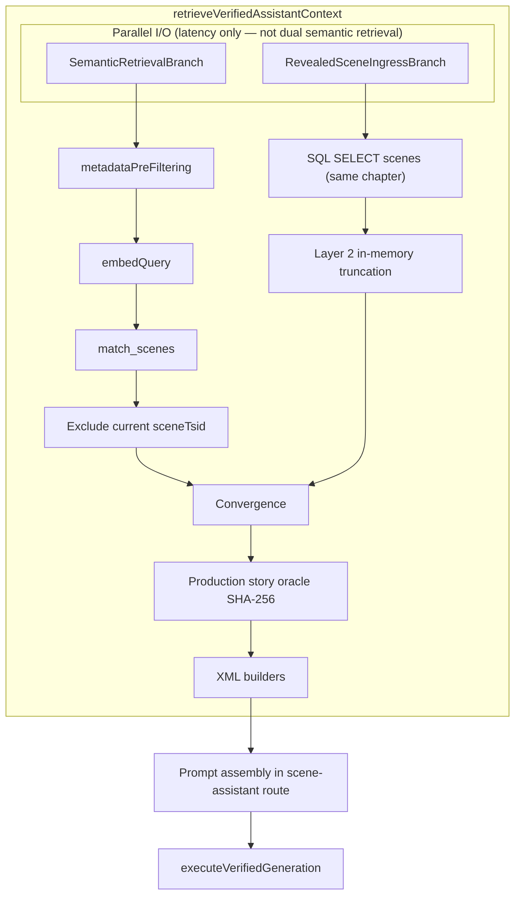

# ADR-002: Hybrid RAG with Two-Layer Visibility Boundary

> **Vocabulary Notice:** This document uses implementation symbols (`Scene`, `sceneTsid`, `story_images_v2`,
> `caption`, `order_index`). Normative Runtime vocabulary is `Reading Route` (impl: Scene) and
> `Reading Frame` (impl: Story Images). See `governance/vocabulary/runtime-lexicon.md` in `raree-show-admin`.

> **Amendment A (Accepted 2026-11-17, not yet implemented):** The Decision below remains the original hybrid-RAG decision and the description of the deployed default path. Explicit reader authorization, and the rule that the default path injects captions from the SQL candidate set instead of untruncated `scenes.summary`, are recorded only in [Amendment A](#amendment-a--explicit-reader-authorization). Product behavior and budgets stay in [Reader Guide 2.0](../specs/reader-guide-2.0-spoiler-authorization.md). The paired visibility law is [Amendment A of the visibility invariant](../specs/ADR-002-VISIBILITY-INVARIANT-SPEC.md).

## Context

### Current limitation

The Scene Assistant initially relied on a static retrieval scope. The system could not answer questions that depend on which scenes the reader is allowed to know about, and could not bind model-visible narrative to the reader’s actual position in the work.

### Specifically

1. Cross-scene questions (e.g. where a character appeared earlier) were not supported by a scoped retrieval universe.
2. Responses could include narrative the reader has not yet reached (spoiler risk).

### Prior state

- Phase 1 delivered embedding backfill in CMS and a debug retrieval endpoint; that endpoint was not yet part of the Scene Assistant runtime.
- The product requires query-aware retrieval scope and **non-bypassable limits on how narrative and progress propagate** through the Scene Assistant pipeline (retrieval stage vs prompt/token stage).

### Need

- The Scene Assistant must use retrieval scope that reflects the reader’s progress and the active scene.
- Spoiler isolation must be enforced **independently of model compliance**: boundaries are system guarantees, not prompts asking the model to behave.

### Constraints (from product and system requirements)

- SQL filtering is a **mandatory** step before vector similarity runs; vector search must not widen visibility beyond SQL-approved scene candidates.
- Vector semantic reranking is **mandatory** on every query that uses hybrid retrieval; it always runs on SQL output.
- The retrieval topology remains a **single serial pipeline**: SQL filter, then vector rerank. No routing that skips SQL. No branch that runs vector without SQL first.
- Story-level spoiler control for the **current** scene must not rely on sending full captions and instructing the model to ignore unread slides.

---

## Decision

### Hybrid RAG serial pipeline

Hybrid RAG is a **two-stage serial pipeline**.

1. **SQL retrieval (`metadataPreFiltering`)** acts as the mandatory safety gate. It builds the candidate set of scenes the reader may retrieve against, using `chapter_number` and `order_index` with lexicographic “read up to” semantics tied to committed progress (`readUpToChapter`, `readUpToOrderIndex`).
2. **Vector retrieval (`match_scenes`)** performs semantic reranking **only** on that candidate set. Vector operates on SQL output; it does not introduce scenes outside the SQL-approved set.

**Topology (mandatory):**

```text
SQL filter → vector rerank
```

This is not routing. This is not conditional fallback.

---

### Scene Assistant ingress topology (deployed)

Scene Assistant ingress is implemented in `retrieveVerifiedAssistantContext` (`src/services/retrieval.ts`). Two I/O paths run **in parallel for latency** via `Promise.all`; they **converge** before the function returns (production oracle + XML builders). This is **not** dual semantic retrieval.



Generation after this ingress is [ADR-003](003-multi-provider-ai-runtime.md). The route calls `executeVerifiedGeneration` with Gemini (`gemini-3.5-flash-lite`) as primary. OpenRouter runs only when `OPENROUTER_API_KEY` is set and Gemini fails before the first text token. Client abort is forwarded as `AbortSignal` and does not re-enter retrieval ([ADR-013](013-scene-assistant-cancellation-semantics.md)).

**Branch A — semantic retrieval** (`retrieveScenesUncached`):

* Serial hybrid path: SQL gate → embed → `match_scenes` vector rerank.
* Query-dependent.
* Current scene (`sceneTsid`) is excluded from results before prompt assembly to avoid whole-scene RAG text bypassing story truncation.

**Branch B — deterministic revealed-scene ingress** (`fetchChapterScenesWithinProgress`):

* SQL read from `scenes` (same chapter, within progress bounds) plus Layer 2 in-memory caption truncation.
* **No** embedding, **no** `match_scenes`, **not** query-dependent.
* **Not** vector retrieval, **not** a hybrid retrieval branch.

**Trust semantics:**

| Source | Role | Oracle authority | Query-dependent |
|--------|------|------------------|-----------------|
| `chapterScenes` (Branch B) | Authoritative revealed-state grounding | Yes — gates LLM ingress | No |
| `results` after rerank (Branch A, current scene excluded) | Supplementary semantic context in `<context>` | No | Yes |

Prompt assembly in `src/app/api/scene-assistant/route.ts` combines: current-scene revealed XML, same-chapter revealed-scene XML (Branch B), and semantic `<context>` (Branch A).

---

### Visibility Boundary (Phase 3) — definition

**Visibility Boundary** is the **maximum propagation scope** for narrative and progress information **through the Scene Assistant pipeline**—from retrieval through prompt assembly to the LLM. It is **not** a single “model-visible” ceiling for every stage: Layer 1 governs **retrieval-visible** scope (which scenes may enter hybrid search), while Layer 2 governs **model-visible tokens** for specific narrative units (slide captions) in the current scene. Spoiler isolation is enforced independently of model compliance at each stage.

**Narrative atoms:** The smallest narrative fragments that Layer 2 addresses for spoiler control—here, the per-slide **caption** for each entry in the **effective story list** derived from `story_images_v2`, in array order. Other system-prompt fields (scene title, summary, location, etc.) are governed separately; unless stated otherwise, **narrative atom** means one such slide-level caption.

#### Layer 1 — Retrieval Visibility Boundary (SQL Gate)

The Retrieval Visibility Boundary is enforced during **`metadataPreFiltering`**. It constrains **retrieval-visible** scope (candidate scenes for hybrid search). It is **not** the same as Layer 2’s model-token ceiling; scenes may be retrieval-eligible while only a slice of the current scene’s **narrative atoms** is model-visible.

**Responsibilities:**

- Scene-level physical isolation of the retrieval universe.
- Upper bound on the candidate set before vector reranking.
- Semantic retrieval safety gate: only SQL-approved scenes enter the retrieval universe.

**Mandatory constraints:**

- `match_scenes` operates **only** on SQL-approved candidates.
- Vector retrieval does **not** expand visibility beyond that set.

#### Layer 2 — Prompt Visibility Boundary (in-memory truncation)

The Prompt Visibility Boundary is enforced during **prompt assembly** after retrieval completes and **before** any LLM call.

**Responsibilities:**

- Story-level logical isolation within the current scene.
- Token-level spoiler prevention for **narrative atoms** (slide captions from `story_images_v2` in effective story order).
- Partial visibility for the **current** scene only.

**Retrieval independence:** Layer 2 truncation is applied on the **revealed-scene ingress** path (Branch B). It does **not** change vector rerank inputs, the SQL candidate set, or rankings. Parallel I/O via `Promise.all` does **not** make Branch B a second semantic retrieval pipeline. Prompt-side truncation **does not** add or remove scenes from the SQL-approved universe, **does not** alter **retrieval recall** of scenes. It only limits which **narrative atom** texts from authorized scene rows become **model-visible tokens**.

**Current-scene rule:**

For the current scene (`sceneTsid`), only narrative atoms with indices **`0..readUpToStoryIndexLast`** (inclusive) may appear in model-visible tokens. Unread captions must **never** appear in those tokens.

**Architectural role:**

Layer 2 is **downstream prompt construction** over an already authorized retrieval scope. It is **not** semantic retrieval, **not** a second retrieval pipeline, **not** chapter retrieval, and **not** cross-scene retrieval in the ADR-002 sense.

**Same-chapter revealed-scene context (terminology):** Prompt-only reads from `scenes` that load `story_images_v2` (after truncation) and related fields for the system prompt are **same-chapter revealed-scene context**.

**Effective story list** (must match the client ImageReel): entries from `story_images_v2` with non-empty trimmed `url`, in array order; `caption` is a string (empty allowed).

**Progress fields (`ProgressConfig` / client mirror):**

- **Retrieval Visibility Boundary state:** `workTsid`, `readUpToChapter`, `readUpToOrderIndex`.
- **Prompt Visibility Boundary state:** `sceneTsid`, `readUpToStoryIndexLast`.

**Product default (locked):** `readUpToStoryIndexLast` aligns with the client carousel index for the **currently visible** slide, inclusive. If there are no slides, the value is **`-1`** and the server reveals **no** story captions for the current scene. The server **clamps** `readUpToStoryIndexLast` to `[-1, effectiveSlideCount - 1]` per scene.

**Model-visible context:** `match_scenes` similarity / score / distance metadata is **excluded** from the model-facing system prompt (server observability may still log it).

---

### Why two layers instead of restructuring SQL for every story slide

- **Stable retrieval topology:** The SQL → vector pipeline stays one branch; no nested retrieval topology for per-slide rows.
- **Token-granular spoiler control:** Story-level visibility is enforced at prompt assembly granularity without fragmenting retrieval into story-chunk queries.
- **Separation of concerns:** Layer 1 answers **which scenes may propagate into retrieval**. Layer 2 answers **which narrative atoms may propagate into model-visible prompt tokens** for the current scene. The two boundaries are orthogonal stages in the same pipeline.

---

### End-to-end invariant (reader ↔ assistant)

**Assistant retrieval must observe committed visibility boundary state.** Each Scene Assistant invocation carries `userProgress` (`ProgressConfig`); `metadataPreFiltering`, `match_scenes`, and prompt assembly treat those fields as authoritative for Layer 1 and Layer 2. The reader client is responsible for committing progress so that payload matches the reader’s actual position; **client sequencing and UI orchestration** are specified in [W-01: Visibility-Synchronized Navigation](../specs/w-01-visibility-synchronized-navigation.md), not in this ADR.

---

## Alternatives

### Routing

- **Definition:** The system chooses SQL-only or vector-only (or skips one step) based on query type or heuristics.
- **Rejection:** This approach does not satisfy the constraint that **SQL is mandatory before vector**, because it makes SQL not a mandatory step for every hybrid retrieval request, which violates “SQL must be a mandatory safety gate (cannot be bypassed).”

### Fallback

- **Definition:** The system runs SQL first; if results are deemed insufficient, it runs vector without the SQL constraint or repeats with a different path.
- **Rejection:** This approach does not satisfy the constraint that **vector always reranks SQL output as the only semantic step**, because it introduces a path where vector does not operate strictly on the SQL-approved candidate set as the sole mandatory downstream step, which violates the serial “SQL filter → vector rerank” topology.

### Pure vector

- **Definition:** Retrieval uses only vector search with no SQL gate.
- **Rejection:** This approach does not satisfy the constraint that **SQL is mandatory**, because it removes the mandatory safety gate, which violates “SQL must be a mandatory safety gate (cannot be bypassed).”

### Second retrieval pipeline for current-scene captions

- **Definition:** A separate retrieval branch loads or ranks story chunks instead of truncating at prompt assembly.
- **Rejection:** This approach does not satisfy the constraint of **a single serial retrieval topology** for scene-level hybrid RAG; Layer 2 is prompt construction over authorized scope, not a parallel retrieval pipeline. **`Promise.all` parallel I/O must not be documented as dual hybrid retrieval** — Branch B is deterministic revealed-scene ingress, not semantic retrieval.

---

## Consequences

### Benefits

- SQL enforces **Retrieval Visibility Boundary** (what may propagate into retrieval); vector improves relevance **within** that set.
- **Prompt Visibility Boundary** governs propagation of **narrative atoms** into model-visible tokens without changing retrieval topology.
- Serial ordering yields **predictable** behavior for debugging and operations.
- The end-to-end **invariant** above ties server boundaries to request payloads; compliant clients (W-01) keep `userProgress` aligned with the reader’s position.

### Trade-offs

- Two-stage retrieval adds **end-to-end latency** versus a single stage.
- Operators and developers incur **higher debugging cost** when separating SQL filter effects from vector rerank effects.
- **Dual-layer** visibility requires discipline in prompt assembly on the server and in how clients submit `userProgress` (see W-01) so Layer 1 and Layer 2 stay consistent end-to-end.

---

## Validation

- **SQL gate:** `match_scenes` is invoked only with candidate tsids produced by `metadataPreFiltering` (no expansion outside that set).
- **Vector on SQL output:** Embedding and RPC operate on the filtered candidate universe for each request.
- **Prompt truncation:** Current-scene `story_images_v2` captions are sliced to `0..readUpToStoryIndexLast` before any LLM invocation.
- **Unread captions (negative guarantee):** For the current scene, **narrative atoms** with index **greater than** `readUpToStoryIndexLast` are **absent** from model-visible tokens—enforced by construction (truncation before the LLM), not by instructing the model to ignore unread slides.
- **Layer 2 vs retrieval recall (negative guarantee):** Verified traces show Layer 2 truncation does not change which scenes are candidates for retrieval or how they are ranked; it only filters prompt text **after** retrieval.
- **Committed boundary on requests:** Scene Assistant API inputs use `userProgress` as the committed visibility boundary snapshot for that turn; client-side ordering and reset semantics are validated under [W-01](../specs/w-01-visibility-synchronized-navigation.md).

---

## Refs

- Retrieval implementation: `src/services/retrieval.ts` (`metadataPreFiltering`, `retrieveScenes`, `retrieveVerifiedAssistantContext`, `fetchChapterScenesWithinProgress`).
- Production story oracle: `src/lib/production-story-oracle.ts`.
- Scene Assistant API: `src/app/api/scene-assistant/route.ts`.
- Client navigation spec: [W-01: Visibility-Synchronized Navigation](../specs/w-01-visibility-synchronized-navigation.md) (`ReadingRouteExperience.tsx`, `useReadingRouteNavigation.ts`).
- Reading frame filtering alignment: `src/lib/reading-frames.ts`.
- Amendment A product contract: [Reader Guide 2.0](../specs/reader-guide-2.0-spoiler-authorization.md).
- Amendment A visibility law: [ADR-002-VISIBILITY-INVARIANT-SPEC](../specs/ADR-002-VISIBILITY-INVARIANT-SPEC.md).

### Follow-up (granularity)

- Story-level embedding chunks (ADR-001 evolution) if RAG text must align exactly with story boundaries without post-filtering.

---

## Amendment A — Explicit reader authorization

**Status:** Accepted on 2026-11-17. Not implemented in `src/services/retrieval.ts` or `src/app/api/scene-assistant/route.ts`.
**Normative pair:** [ADR-002-VISIBILITY-INVARIANT-SPEC Amendment A](../specs/ADR-002-VISIBILITY-INVARIANT-SPEC.md).
**Product contract:** [Reader Guide 2.0](../specs/reader-guide-2.0-spoiler-authorization.md) §§6–9. This amendment does not copy the authorization-card UI.

The original Decision stands. It recorded a pipeline that had no separate reader grant, so the progress fields were both the reading position and the only visibility ceiling. Amendment A keeps the pipeline and splits those two roles. Progress remains the default ceiling. A validated grant is the only exception.

### A.1 Principles that do not change

These are structural. They are not defaults that existed only because authorization was missing.

1. The order is SQL candidate set, then embedding, then `match_scenes`, then context assembly. Vector search does not add scenes outside that set. There is no second semantic pipeline, and there is no route that skips SQL.
2. `match_scenes` receives only the tsids from that request's candidate set, together with `work_id_filter` for the resolved work. A returned tsid outside the set fails the request.
3. A narrative atom is one caption in the effective `story_images_v2` list. On the default path, atoms past the current route's frame boundary are omitted before the model call. The model is not asked to ignore text that was still placed in the prompt.
4. Scenes from another `work_id` never enter the candidate set or the prompt.
5. Similarity, score, and distance stay out of the model prompt.
6. An empty `match_scenes` array is an empty ranking. It is not an empty work, and it is not a technical failure. A thrown embedding call or RPC error stays a technical error. The assistant must not describe that error as plot which has not been revealed, and the server must not skip the vector step in order to hide the error.
7. Text already present in model weights is not a narrative atom. Prompt rules may constrain it. Physical truncation does not delete it.

### A.2 Default path

`spoilerMode` is omitted or `"none"`.

The SQL candidate set is unchanged from the original Layer 1 rule. After `workTsid` resolves to `work_id`, and after `sceneTsid` is confirmed to belong to that work, the set is every scene of that work where `chapter_number < readUpToChapter`, or `chapter_number = readUpToChapter` and `order_index <= readUpToOrderIndex`.

Caption bytes are read from that same set: `work_id` matches and `tsid` is in the candidate set. The read does not invent a second, narrower chapter predicate. `match_scenes` does not supply those bytes. A null `rag_embedding` may make the ranking empty; the caption read still happens, so already-read captions are not dropped merely because they were never embedded.

Frame rules, applied in memory:

- A route behind the progress point, meaning a lower chapter or the same chapter with a lower `order_index`, contributes every effective-frame caption.
- The current route, `sceneTsid`, contributes captions `0..readUpToStoryIndexLast` inclusive. The index is clamped to the effective frame list. A missing index, a non-integer, or a value below `-1` still fails fast.
- A different route with the same chapter and the same `order_index` contributes no captions.

On this path, `scenes.summary` and the client-supplied summary are not narrative facts. The original ADR governed summaries separately from narrative atoms, and the deployed prompt injected the current summary without a frame cut. That channel can carry later frames. Amendment A closes it for the default path. Character names and the place name may remain. Character descriptions are not added.

`match_scenes` still reranks only inside the candidate set. Its order matters when the prompt budget omits whole routes. The budget and the omission order are the product contract §9. Omission drops an entire route rather than slicing one route's story. The current route's already-read captions are kept inside the frame rule above. Dropped captions are not replaced with summaries.

A larger `readUpToChapter` or `readUpToOrderIndex` is still only a client progress declaration. It does not select this amendment's exception. No server reading ledger is introduced, so the default path still cannot prove that the client did not raise its own progress.

The model must not volunteer plot past the revealed captions. That duty stays in the prompt. It does not replace the caption cut.

### A.3 Explicit exception

The exception applies only when the server has validated the request. It is not inferred from progress numbers, from the wording of the question, or from an earlier request that is not repeated.

`single_request`:

- `spoilerMode` is `"single_request"`.
- `authorizedQuestionId` is present and equals the `questionId` of the last user message.
- Otherwise the server rejects the request and does not widen the candidate set.
- The server stores no grant. The next message does not inherit this mode.

`conversation`:

- `spoilerMode` is `"conversation"` on that request.
- The reader turned the mode on. Each later request must carry it again.
- After the reader turns it off, the next request is `"none"`.
- Topic detection does not open or close the mode.

Both modes:

- `sceneTsid` belongs to the `work_id` resolved from `workTsid`. If it does not, the request is rejected.
- The SQL candidate set is every ingested route of that `work_id`. The server computes the set. Client progress is not the ceiling, and the client cannot submit an "authorized through chapter N" bound.
- `match_scenes` reranks only that set.
- Captions placed in the prompt for those routes are not cut at `readUpToStoryIndexLast`. The vector step must not see later routes while the prompt still receives only the default-path captions.
- A summary may be injected only for a route whose captions were included, and only from that route's stored summary. A summary does not replace a route whose captions were omitted.
- Tsids of another work cannot be inserted by the client.

When the exception is over, the next `"none"` request uses §A.2. Keeping an earlier spoiler answer on screen does not keep the expanded candidate set.

### A.4 History integrity is not the SQL gate

An assistant turn produced on the expanded path must not be replayed into the model context of a later `"none"` request. The product contract seals a completed assistant turn with an HMAC over the retrieval mode and the visible text. On `"none"`, the server drops an assistant turn whose seal is missing, invalid, or marked as expanded disclosure.

The seal checks provenance of an assistant message. It does not build the SQL candidate set, and it does not prove that the prose contains no unread plot. User messages are not sealed. Field-level rules stay in the product contract §§7–8.

### A.5 Story oracle

The production story oracle continues to hash caption bytes only: raw UTF-8, no separators, no trim. It still fails closed when the chunk list and the concatenated buffer disagree. RAGAS v2 keeps that caption boundary. Summaries and character-card text stay outside the hash.

What changes is the caption set being hashed, not the kind of field. The hash covers captions actually placed in the prompt after the frame rules and the budget. Captions fetched and then dropped are not hashed. Route order for the hash is `chapter_number`, then `order_index`, then `tsid`. The request fingerprint gains the visibility mode and does not absorb story bytes. The algorithm remains in `src/lib/production-story-oracle.ts`.

### A.6 Limits

This amendment does not make the assistant an absolute spoiler-safety system.

1. Without a server reading ledger, the default path cannot prove that the client did not raise `readUpToChapter` or `readUpToOrderIndex`.
2. The default path cannot delete later plot from model weights.
3. The server cannot reliably classify spoiler text that the reader types into a user message.
4. A valid HMAC shows the retrieval mode and that the sealed assistant text was not edited. It does not show that the model withheld unread plot.
5. The expanded set is the work's ingested routes. It is not the complete literary source.

No reading ledger, account-level permission, or session database is added here.

### A.7 Data flow

```text
resolve work_id from workTsid
  → reject the request if sceneTsid is not in that work
  → SQL candidate set
       none: progress bound in §A.2
       single_request or conversation, after §A.3: every ingested route of work_id
  → embedQuery
  → match_scenes on that set only
  → read story_images_v2 for the same tsids
  → §A.2 frame rules, or no frame cut on the exception path
  → prompt budget from the product contract
  → story oracle over the injected captions only
  → prompt
  → generation
```

An empty ranking continues into caption assembly. A thrown embedding call or RPC does not.

### A.8 Accepted checks

1. `"none"` still names the progress SQL filter.
2. Without a validated grant, captions past `readUpToStoryIndexLast` on the current route do not enter the model context.
3. A validated grant opens only the ingested routes of the current `work_id`.
4. The SQL candidate set is still built before vector rerank.
5. An empty embedding result does not erase captions that the SQL set already admitted.
6. The caption read uses the same tsid set as the SQL gate.
7. The default path does not use an untruncated summary to pass the frame boundary.
8. `single_request` does not apply to the next message.
9. `conversation` changes only when the reader sends that mode, not when the topic changes.
10. The story oracle still hashes captions, not summaries or character cards.
11. The HMAC is a message-integrity check, not an absolute safety boundary and not a replacement for the SQL filter.
12. Both candidate sets remain limited to one `work_id`.
