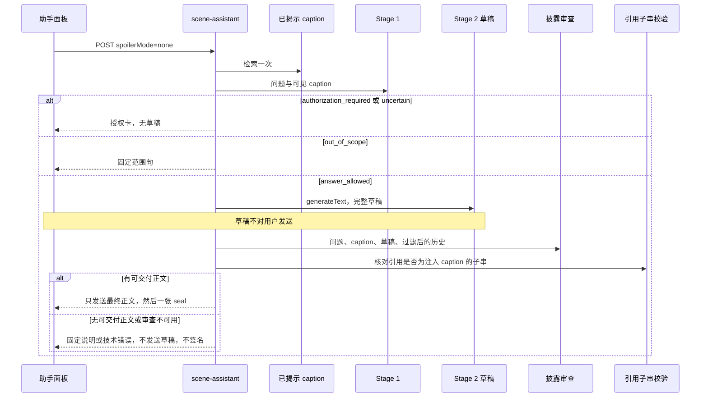

# Reader Guide 2.0 — P2-B.2 缓冲式答案披露审查设计

**Status:** Deferred. Not implemented. Not on the active roadmap.  
**Date:** 2026-11-17  
**Deferred:** 2026-11-17  
**Repository:** raree-show-web  
**Path:** `docs/specs/reader-guide-2.0-answer-disclosure-audit-design.md`  
**Does not change:** 应用代码、Prompt、Provider、测试、数据库、HMAC 实现、前端组件、检索范围、授权语义、阅读进度。  
**Does not claim:** Spoiler leakage fixed. P2-C acceptance passed.

## 决策记录

2026-11-17 决定暂停 P2-B.2，不实施本文的缓冲审查、第二次模型调用、主张拆分、引用校验链和自动重写。下文保留原设计，供以后重读，不是当前待办。

暂停原因：

1. 产品核心是读者自己决定是否接受剧透，不是多模型审核。
2. LLM 审查不能证明隐性剧情推论都已拦住。
3. 整稿缓冲和额外模型调用会再拉长已经偏慢的回答。
4. 独立产品要先控制架构复杂度、运行成本和等待时间。

当前路线保持已实现的流程：默认 `none`，Stage 1 决定是否出示授权卡，`answer_allowed` 用现有无剧透提示流式生成。Prompt 只降低泄漏概率，不承诺零泄漏。已保留的失败记录包括南华老仙授书、张宝与张梁、太平道撼动汉室，以及群雄并起序幕。

重新评估的触发条件：以后如果产品明确接受更长等待，并且仍认为残余泄漏不可接受，可以再打开本文。在那之前，不新增审查模块，不把流式回答改成草稿缓冲。

P2-C 验收没有通过。暂停 P2-B.2 不改变这个状态。

相关评估：`docs/specs/reader-guide-2.0-residual-spoiler-risk-review.md`。该评估第 4 节的实施建议已随本决定延期。

---

## 1. 目标

无剧透 Stage 2 增加一层独立的答案披露审查。它不证明模型绝对不会剧透。它要保证：

1. 无剧透草稿在审查完成前不进入用户可见流。
2. 故事专属事实必须能指向本次已揭示 caption。
3. 只允许有限的静态背景。
4. 没有披露资格的故事事实被拒绝或从交付文本中移除。
5. 审查失败时安全降级，不默认放行。
6. 已授权的 `single_request` 和 `conversation` 保持现有流式生成和 seal。

---

## 2. 数据流



已授权请求不进入 `S2 草稿 → Audit → Check`。它们仍调用现有 `executeVerifiedGeneration`，第一个正文分块之后不换供应商。

检索只做一次，发生在 Stage 1 之前。审查器不得再查数据库，不得读取进度外 caption、未注入的候选、summary 或人物卡。

### 2.1 复用 `generateText`

`AIModelProvider.generateText` 已经接收 `system`、`messages`、`timeoutMs` 和 `abortSignal`，并返回完整 `text`。无剧透草稿和审查都用这次非流式调用。

不需要新的流式 runtime 接口。`streamText` 继续只给已授权模式。无剧透路径在审查通过后，由路由把最终字符串切成 `text-delta` 再发一张 seal。这些分块不是供应商流，不触发 ADR-003 的供应商锁定，也没有第二个供应商可以在分块之后接上。

草稿生成失败时，可以在任何用户可见正文之前换备用供应商，规则与 Stage 1 相同：客户端信号已中止则 499，不再调用备用供应商。审查调用同样遵守这个区分。

---

## 3. 审查输入与输出

审查调用的输入只有：

1. 当前用户问题。
2. 本次实际注入 Stage 2 的已揭示 caption 原文。语料是帧规则和预算之后的 `revealedStorySlides[].caption`，与 Story Oracle 哈希的字节相同。不是预算前的原文，不是 `match_scenes` 里未注入的行，不是 XML 转义后的展示层。
3. Stage 2 的完整草稿。
4. 无剧透披露规则。审查提示单独编写，不复用 Stage 2 里允许补充知识的系统提示。
5. `historyForModel` 已经过滤过的对话。用户自己写下的剧透可以留下，但不是授权，也不是 caption 证据。更早的助手回答不能当作引用语料。

审查器要读整份草稿，按句子或独立主张切分，而不是搜索禁词。

输出必须是一个 JSON 对象：

```ts
type DisclosureDecision = "approved" | "rejected" | "uncertain"

type ClaimClass =
  | "caption-supported"
  | "static-background"
  | "unsupported-story-fact"
  | "uncertain"

type DisclosureClaim = {
  quote: string
  classification: ClaimClass
  evidence: string
  reason: string
  deliverable: boolean
}

type DisclosureAudit = {
  decision: DisclosureDecision
  claims: DisclosureClaim[]
}
```

`quote` 是草稿中的连续原文。`evidence` 只有 `caption-supported` 才应非空，并且必须是某一条注入 caption 的精确子串。没有主张列表、决策非法、或 JSON 无法解析，都按审查失败处理，不把草稿放行。

整体决策不能代替逐项结果。宽泛回答里要能指出哪一句越界。

---

## 4. 确定性校验与语义审查

这是两件不同的事。

| 检查 | 谁做 | 能证明什么 |
|---|---|---|
| 引用真实性 | 服务端字符串包含关系 | 引用确实来自本次注入的 caption |
| 语义支持 | 审查器 | 它认为这句主张没有超出那段 caption。这不是结构保证 |

### 4.1 Caption-supported

故事专属事实要有本次注入 caption 的证据。服务端对每条 `caption-supported` 主张执行：

- `evidence` 非空，且是某一条注入 caption 的精确子串。
- 子串不能只存在于预算前文本、未注入候选、summary、人物卡或客户端字段。
- 引用失败时，该主张改为不可交付。不得改判成 `static-background`。

引用成功仍不表示主张成立。caption 写了黄巾起义爆发，模型引用这句话，却把起义说成后来群雄时代的开端，引用是真的，语义支持是假的。审查器必须把这种主张标成 `unsupported-story-fact` 或 `uncertain`。程序不把「引用存在」升级成「语义成立」。

### 4.2 Static-background

可以没有 caption 引用的，只限一般性背景：时代、地理、制度、文化习俗，以及宗教和社会的一般信息。

下列内容不能靠分类标签变成静态背景：

- 人物身世、师承、早年经历。
- 未揭示的人物关系。
- 组织在故事里的后续历史。
- 未揭示事件及其经过。
- 事件后来的结果和影响。
- 后世评价。
- 用历史背景包装的剧情因果，例如把当前起义说成撼动政权或开启后来的时代。

静态背景可以提到 caption 里已经出现的人名或组织，但只能复述 caption 已经给出的身份，不能借这个名字附加传记或后来的后果。名字出现在 caption 里，不是附加事实的许可证。

不建背景知识表，不把白名单写进 Story Oracle。服务端没有第二份知识库可做确定性核对。因此「这是静态背景」始终是审查器的判断。它漏判时，残余风险还在。

### 4.3 不可交付与不确定

故事相关事实没有可靠依据时，不默认放行。

服务端覆盖审查器的 `deliverable`：

- `unsupported-story-fact` 或 `uncertain`：一律不可交付。
- `caption-supported` 但引用校验失败：不可交付。
- `static-background` 只有在分类正好是这个值、且审查器认为可交付时才保留。审查器若不确定，必须输出 `uncertain`，不能改标成静态背景。

---

## 5. 失败与修订

| 方式 | 剧透风险 | 语义完整性 | 事实依赖 | 额外调用 | 主要问题 |
|---|---|---|---|---|---|
| A. 整份拒绝，固定说明 | 最低。用户看不到草稿 | 差。安全部分也丢掉 | 不需要处理句间依赖 | 无 | 宽问题容易变成拒答 |
| B. 删掉不可交付的句子 | 中。残留句子仍可能暗示被删的后果 | 中。连接词和指代会悬空 | 高。后句常依赖前句 | 无 | 局部删除造成错误表达 |
| C. 按审查结果重写，再完整审查 | 取决于第二次审查。重写稿不能直接可见 | 较好 | 重写时可以避开被拒事实 | 一次草稿加一次审查 | 不限制次数就会反复泄漏 |

推荐组合，而不是单选：

1. 先做引用校验，并按第 4.3 节覆盖可交付标志。
2. 若每一项都可交付，交付整份草稿。这是 `approved`。
3. 若存在不可交付项，不允许把原草稿或只删句子后的残稿直接给用户。允许一次重写。重写输入是原问题、注入 caption，以及被拒绝的主张清单。重写稿是新的草稿，必须重新走完整审查和引用校验。
4. 第二次审查后，只交付仍然可交付的完整句子。如果没有这样的句子，或剩余文本无法独立成句，交付一条服务端固定说明：当前阅读范围不能确认更完整的回答。
5. 重写最多一次。没有第三次生成。

审查服务超时、返回非法 JSON，或在一次修复后仍然非法：这不是「审查通过」。不发送草稿。用户看到技术错误，没有 seal。固定说明只用于审查已经完成、但没有可交付句子的情况。审查器不可用时，不能用固定说明假装审查已经做过，也不能因此放行草稿。

---

## 6. 交付、延迟与历史

2026-11-17 的实测里，第 0 帧一次无剧透请求的检索大约 2–4 秒，连同 Stage 1 和短回答的总时间大约 8–15 秒。缓冲路径在此之上增加：

- 一次完整草稿。长度通常是一段回答，输入侧还要带上本次 caption，上限仍是现有 24000 字符预算。
- 一次审查。输入是问题、caption 和整份草稿，输出是主张 JSON，通常长于草稿。
- 只有需要重写时，再加一次草稿和一次审查。

因此无剧透放行问题的首字会从「流开始」挪到「草稿加审查结束」。按上述实测，常见路径大约再增加 4–12 秒；走到重写时大约再增加 6–14 秒。这是从现有请求时长推的量级，不是新的压测。授权卡和已授权流式路径不加这层。

审查通过后，路由把最终字符串按句或按固定长度切成 `text-delta`，再发一张 seal。UI 仍可以沿用现有动画。用户在此之前看不到 token。

取消和超时：

- 草稿或审查期间客户端断开：499，不签名，不发送已生成的草稿。
- 审查通过后的分块发送中途断开：屏幕上可以留下已发出的最终文本片段，但不签名。这与现在的流中断相同。
- 草稿超时按技术错误处理，不发送半截草稿。

历史和签名：

- 用户看不到未审查草稿。
- 草稿、审查 JSON 和被拒绝的主张不进入可信历史，也不签名。
- 审查失败不签名。
- 只有最终通过并正常交付的正文签一次。
- 一次请求不能既留下未审查回答，又留下审查后的回答。

已授权模式的流式交付和 seal 语义不变。

---

## 7. 与现有组件的关系

| 组件 | 实现本设计时 |
|---|---|
| `assistant-stage1.ts` | 不改判定、JSON 和重试。它仍只做问题级闸门 |
| `scene-assistant/route.ts` | 改无剧透 `answer_allowed` 分支：`generateText`、审查、校验，再发送最终 SSE。授权分支保持返回 |
| `assistant-system-prompt.ts` | Stage 2 无剧透提示可以保留。审查规则用单独的提示，不把 Stage 2 提示当作审查提示 |
| `runtime/types.ts` | 不需要新接口。`generateText` 已够用 |
| 两个 provider | 不改适配器。审查是另一次 `generateText` |
| Story Oracle | 不改。引用语料就是已经哈希的 caption 原文 |
| turn seal | 只签最终正文。不改 HMAC 算法 |
| `historyForModel` | 不改。未签名草稿本来就不会进入模型历史 |
| 前端 SSE | 不改事件类型。无剧透放行会更晚才收到第一段 `text-delta` |
| P1/P2-A/P2-B 测试 | 保留。另加审查结构测试，不删已有失败回归 |

不改变授权语义、检索范围、用户进度或会话状态。

---

## 8. 为什么是组合，而不是单一保证

继续强化 Prompt 的成本最低，但 P2-B.1 之后「太平道是什么」仍用后来的统治冲击评价当前组织，「张角为什么发动起义」仍补出张宝、张梁。提示降低频率，不约束答案级事实。

独立审查看的是已经写出来的草稿，所以比问题级 Stage 1 更接近泄漏位置。同一次对话里的自审容易沿用草稿的理由。审查必须是另一次调用，系统提示只包含披露规则和注入 caption，不包含 Stage 2 的补充许可。有备用供应商时，优先用另一个供应商做审查。即使用另一个模型，它仍可能漏掉没有专名的隐性推论。审查通过不是安全证明。

逐条主张加上 caption 子串校验，能挡住伪造引用和「引用了一段无关原文」。它不能挡住引用为真、解释越界。来源标签不是证据。

静态背景白名单用来限制审查器可以不引用 caption 的范围。不把它做成新表，也不放进 Oracle。人物关系、组织后续历史和故事专属事件没有 caption 子串就不能交付。

多轮历史里的助手句子不是证据。复杂句子、隐含因果和评价性表达是审查器最容易漏的部分，也是「撼动汉室」「拉开时代」这一类失败的形态。验收要看语义，不只看原句是否再现。

---

## 9. 验收

### 9.1 结构性测试

用假的草稿和假的审查 JSON，不调用真实模型：

- 无剧透 `answer_allowed` 在审查完成前没有 `text-delta`。
- 授权和 `uncertain` 不生成草稿。`out_of_scope` 仍是固定句。
- 已授权模式不调用审查，仍走流式。
- 检索次数仍是一次。
- 引用不是注入 caption 的子串时，主张不可交付。
- 引用为真但审查器标成越界时，主张不可交付。
- `uncertain` 和 `unsupported-story-fact` 不能因为标成可交付就放行。
- 非法审查 JSON 不发送草稿，不签名。
- 重写最多一次，第二次审查失败后不发送第二次草稿原文。
- 最终正文只签一次。草稿和审查 JSON 没有 seal。

### 9.2 真实模型回归

仍用《三国演义》第一条路线、第 0 帧。这是行为评估，不是安全证明。

- 「介绍一下张角」不补充南华老仙授书。
- 「太平道是什么」不用后来的统治影响评价当前组织。
- 「张角为什么发动起义」不补充未揭示的张宝、张梁。
- 不用群雄并起、汉室衰落或其他后续格局总结当前事件。
- caption 已经支持的起义和招募仍要回答。
- 时代、地理、制度和文化的一般背景仍可以补充。
- 宽泛问题不能整题变成拒答。
- 已授权的「张角后来怎么样了」不受这层审查约束，仍可以写后续剧情。

任一残余泄漏都要留下原始回答。审查器当时标成静态背景，而正文仍含后续因果，记为审查漏判，不改成通过。

---

## 10. 若将来重新开启时要改的文件

本节不是活跃任务。P2-B.2 已延期。在决策记录的触发条件满足之前，不要按本节改代码。

- 新增 `src/lib/assistant-disclosure-audit.ts`：解析审查 JSON、覆盖可交付标志、校验引用子串、决定交付或重写。
- 新增审查提示构造。不替换现有无剧透 Stage 2 提示。
- 修改 `src/app/api/scene-assistant/route.ts` 的无剧透 `answer_allowed` 分支。
- 新增结构测试。保留 P2-A/P2-B/P2-C 测试和已有失败案例。
- 不改 `assistant-stage1.ts` 的判定，不改 provider 适配器，不改 `runtime/types.ts`，不改 Oracle、检索、HMAC 算法和前端组件。

---

## 11. 仍会留下的风险

- 审查器可以把后续因果误标成静态背景。服务端没有知识库能推翻这个语义判断。
- 同模型审查会比另一个供应商更容易沿用草稿的说法。换供应商也不是保证。
- 一次重写仍可能换一种说法写出同一类事实。第二次审查若漏判，正文会交付。
- 删句和重写都可能让安全部分变短。这是为了不把残稿直接发出去。
- 无剧透放行的首字会变晚。
- 客户端进度在 `none` 下仍被信任。授权范围仍是已入库路线。模型权重里的原著情节仍然存在。
