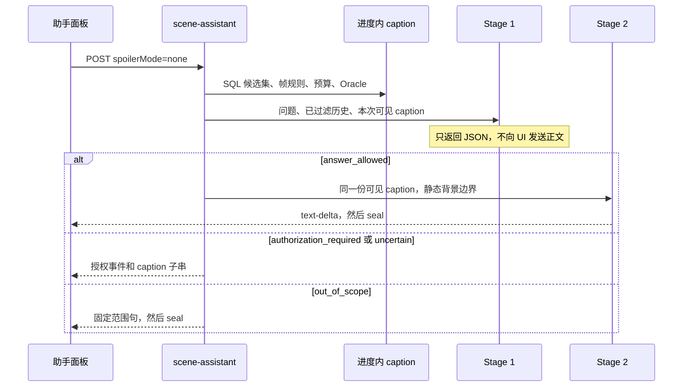

# Reader Guide 2.0 — P2 两阶段生成设计

**Status:** P2-B implemented; P2-C acceptance pending  
**Date:** 2026-11-17  
**Frozen:** 2026-11-17  
**Implemented:** 2026-11-17 P2-A、P2-B、P2-B.1 提示收紧，以及 P2-C 结构测试。浏览器验收尚未全部完成。  
**Repository:** raree-show-web  
**Path:** `docs/specs/reader-guide-2.0-p2-two-stage-generation-design.md`  
**Does not change:** ADR、P1 验收审计、P0/P1 契约原文。不能视为剧透泄漏已修复。

P0/P1 契约仍以 `reader-guide-2.0-spoiler-authorization.md` 为准。本文规定如何补上它没有挡住的交付漏洞，并冻结 2026-11-17 已确认的四项产品决定。P2-A 已让 `none` 请求在 Stage 1 完成之前不发送模型自由叙述。第 6.1 节原文不改。P2-B 与 P2-B.1 已把无剧透 Stage 2 收紧到当前阅读进度：未揭示的前史和事后格局都不是静态背景。真实模型仍可能写出这类事实，因此不能视为剧透泄漏已修复。

---

## 1. 当前问题与根因

P1 的无剧透检索没有把进度外的 caption 放进提示词。2026-11-17 的真实运行里，第 0 帧问「张角最后的下场是什么？」时，可见散文仍包含「因病去世」，标记在句末。`splitSpoilerMarker` 只删掉结尾标记。`SpoilerMarkerTail` 只暂扣约一个标记的长度，更早的增量已经作为 `text-delta` 发出。

因此标记只能打开授权卡，不能撤回已经显示的句子。Prompt 里的禁令发生在采样之后，只能降低概率。`assistant-request-prompt.ts` 不截断模型输出。第一个正文分块发出后，ADR-003 不允许再换供应商。

---

## 2. 已确认的产品决定

1. 授权前用户只能看到服务端授权卡，以及从本次已揭示 caption 取出的原文短句。没有合适子串时只显示卡片。模型不得在授权决定之前生成或发送自由叙述。摘录必须是本次无剧透检索实际注入的 caption 的子串，不能改写。
2. `uncertain` 进入授权卡，不调用 Stage 2。
3. 无剧透 Stage 2 可以补充静态背景，不得主动补充未揭示的动态剧情。这条边界靠 Prompt，不提供零泄漏保证。放行不等于解除来源限制。
4. 已通过校验的 `single_request` 和 `conversation` 跳过 Stage 1，直接进入授权范围内的 Stage 2。`questionId`、扩展检索和 HMAC 契约不变。

---

## 3. 架构与时序

一次 `POST /api/scene-assistant` 完成。不新增路由。检索只做一次，并且先于任何模型调用。

```text
校验 spoilerMode、questionId、scene 归属
  → SQL 候选集 → embedding → match_scenes
  → 读取同一批 tsid 的 caption → 帧规则 → 预算 → Story Oracle
  → 已验证的 single_request 或 conversation：跳过 Stage 1，进入 Stage 2
  → none：
       Stage 1 读取本次可见上下文，只返回 JSON
       answer_allowed → Stage 2 流式叙述
       authorization_required 或 uncertain → 授权事件和 caption 子串，不调用 Stage 2
       out_of_scope → 服务端固定范围句，不调用 Stage 2
```



Stage 1 与 Stage 2 串行。Stage 2 的第一个正文分块之后不换供应商。授权决定完成之前，用户可见流里没有模型自由叙述。

---

## 4. Stage 1

### 4.1 输入

Stage 1 使用本次 `none` 检索已经组装好的可见上下文，也就是将要注入 Stage 2 的那一份：

- 用户问题。
- `historyForModel` 过滤后的历史。用户自己写下的剧透句子留在历史里，但不构成授权。
- 作品名和当前场景标识。
- 当前路线已截断 caption，以及其他已入选路线的已揭示 caption。范围停在 SQL 进度上界、帧规则和 24000 字符预算之后。

不另做一次检索，不放宽候选集，不读取授权路径的后续 caption，不把 summary 或人物卡算进 Story Oracle。判定调用不改 Oracle 的 caption 字节集。

Stage 1 可以读这整份可见上下文，以便判断问题有没有越出它。它不能把这份上下文复述成用户可见答案，也不能为了判断而查看未揭示剧情。

### 4.2 输出

唯一合法输出是一个 JSON 对象，没有 Markdown、前后说明或其他字段：

```ts
type Stage1Decision = {
  decision:
    | "answer_allowed"
    | "authorization_required"
    | "uncertain"
    | "out_of_scope"
}
```

`answer_allowed` 只表示可以进入第 5 节约束下的 Stage 2。它不是调用全部作品知识的许可。

`authorization_required` 与 `uncertain` 对用户相同：授权卡，不调用 Stage 2。日志保留二者的区别。

原始 JSON 不进入 SSE，不进入历史，不签名。

### 4.3 `out_of_scope`

只有问题与当前作品、作品中的人物和事件、以及当前阅读上下文都无关时，才允许 `out_of_scope`。例如询问与《三国演义》无关的烹饪。

不得归入 `out_of_scope` 的情况：

- 与作品有关，但当前 caption 不够回答。
- 与作品有关，但模型不知道细节。
- 与作品有关，但无法判断会不会碰到未读剧情。这种情况是 `uncertain`。
- 当前场景没有点名、但属于这部作品的人物。先判断回答会不会越过已揭示范围；不能因为 caption 没写这个名字就当成范围外。

`out_of_scope` 不打开授权卡。服务端发送现有 locale 范围句，不再让模型写这句。

### 4.4 解析、超时和供应商

Gemini 优先使用结构化 JSON。OpenRouter 不保证相同的 schema 开关。两个供应商都经过同一解析器：整段去空白后必须是上述对象；其他字段、围栏或前后散文都算非法。

同一供应商只再请求一次。第二次仍非法才换备用供应商。备用失败则本次失败。不把非法输出改写成 `uncertain` 或 `authorization_required`，也不进入 Stage 2。用户看到技术错误，没有 seal，没有卡片，没有模型散文。

Stage 1 使用非流式 `generateText`。超时和供应商错误沿用现有文案。主供应商在任何用户可见叙述出现之前失败时，可以换 OpenRouter。叙述流尚未开始，语义锁还没有落下。

---

## 5. Stage 2

### 5.1 何时调用

| 请求 | Stage 1 | Stage 2 |
|---|---|---|
| `none` 且 `answer_allowed` | 已成功 | 使用同一份无剧透检索结果 |
| `none` 且需要授权或不确定 | 已成功 | 不调用 |
| `none` 且判定失败 | 失败 | 不调用 |
| 已验证的 `single_request` | 跳过 | 作品级检索 |
| 显式 `conversation` | 跳过 | 作品级检索 |

`single_request` 的 `authorizedQuestionId` 不匹配则 400，两个阶段都不调用。没有显式 `conversation` 的请求按 `none` 处理，重新走 Stage 1。

### 5.2 静态背景与动态剧情

无剧透 Stage 2 允许补充的静态背景：

- 人物身份、职业和所属组织。
- 历史时代。
- 文化、制度、地理和社会环境。
- 已揭示事件的起因和背景。

禁止主动补充的动态剧情事实：

- 人物死亡和结局。
- 战争胜负。
- 后续身份和经历。
- 未揭示的事件经过。
- 后续事件及其影响。
- 其他必须依赖未来剧情才能成立的事实。

小说、史书、传说和改编必须分开说。补充不能伪装成 Raree 正文或 caption。人物介绍只写身份和静态背景，不把死亡或后来的经历写进介绍。

用户消息或更早对话里出现结局，只说明读者说过这句话。它不是 `single_request` 或 `conversation`，Stage 2 在 `none` 下仍不得展开经过。分类器放行也不取消上面的来源限制。

这些规则写在 Stage 2 的系统提示里。模型仍可能违反。不能把 Prompt 写成零泄漏保证。

授权后的 Stage 2 保持 P1：当前作品已入库 caption、预算内 summary、当前帧人物卡，以及对该作品的模型补充。人物卡标明不是场景正文。不得跨作品。

### 5.3 授权前的摘录

摘录算法由服务端执行：

- 语料只包括本次实际注入、并计入 Story Oracle 的 caption 字符串。
- 若其中一段 caption 包含问题里的人名或事件名，取该 caption 里包含该名字的连续子串，优先当前路线。
- 子串必须能在某一条已注入 caption 上用精确匹配找到。
- 找不到时 `excerpt` 为空，只显示授权卡。
- 不调用模型生成、缩短或改写摘录。

### 5.4 失败与取消

Stage 1 失败，或 Stage 2 尚未发出正文：没有助手气泡，没有 seal。

Stage 2 开始流式之后失败或被取消：屏幕上可以留下已流出的片段，但不签名。下一次请求丢掉没有有效 seal 的助手消息。不补签，不发第二张 seal。

---

## 6. 分类误判

前提：第 0 帧已揭示黄巾起义和张角，没有揭示他的死亡。`uncertain` 的 fallback 一律是授权卡，不进入 Stage 2。

| 问题 | 预期判定 | 误判后的风险 | fallback |
|---|---|---|---|
| 介绍张角这个人物 | `answer_allowed`。只讲已揭示身份和静态背景 | 放行后 Stage 2 仍可能写上死亡 | 若判成不确定或需要授权，只显示卡片和 caption 子串 |
| 张角后来怎么样了 | 需要授权 | 误放行后，Stage 2 的禁令仍可能被违反，写出病死 | 不确定则卡片，不生成 |
| 张角是不是死于疾病 | 需要授权。是非问也是结局 | 误放行后可能回答「是」并补经过 | 不确定则卡片，不生成 |
| 黄巾军后来发生了什么 | 需要授权 | 误放行后可能写出后续战事 | 不确定则卡片，不生成 |
| 黄巾起义对后世有什么影响 | 需要授权或 `uncertain` | 误当成文化背景放行后，可能写到后来的格局 | 不确定则卡片，不生成 |
| 太平道是什么 | `answer_allowed`。静态文化背景 | 放行后可能从教义写到后来的失败 | 不确定则卡片，不生成 |
| 张角为什么发动起义 | 能用已揭示 caption 和起因背景回答则放行；否则 `uncertain` | 放行后可能把后来的战局写成果因 | 不确定则卡片，不生成 |
| 当前场景没提到的某位作品人物是谁 | 先判断回答会不会越过已揭示范围。不能直接 `out_of_scope` | 误当成范围外会少一次授权；误放行可能介绍其后续 | 无法判断则 `uncertain`，卡片，不生成 |
| 与《三国演义》无关的烹饪问题 | `out_of_scope` | 误判成需要授权只会多一张卡片，不泄漏剧情 | 服务端发送固定范围句 |
| 模型不知道作品里的某个细节 | `uncertain`，或在不越界时按可见信息放行。不能 `out_of_scope` | 误放行后可能用猜测补上动态事实 | 不确定则卡片，不生成 |
| 我已经知道张角死了，具体经过是什么 | 需要授权。用户句子不是授权 | 误放行后会展开开棺、传首等经过 | 不确定则卡片，不生成 |
| 多轮从背景追到结局 | 每一问单独判定 | 只放行第一问、后续仍按结局处理。若后续被误放行，Stage 2 可能泄漏 | 任一问不确定就停在卡片 |

分类器不是可靠的安全机制。误放行之后，Stage 2 的 Prompt 不能证明守界。

---

## 7. 授权与 questionId

- 缺省 `spoilerMode` 为 `none`。
- `single_request` 的 `authorizedQuestionId` 必须等于最后一条用户消息的 `questionId`，否则 400。不保存授权。下一条新问题不继承。
- `conversation` 必须每次显式携带。关闭后的下一条是 `none`，重新走 Stage 1。
- 新对话清空内存状态。关面板不重置。换路线仍由组件 `key` 重建。
- 抬高进度只影响 `none` 的 SQL 上界，不变成剧透授权。
- 授权重试不新增用户气泡，沿用原 `questionId` 和原文。
- 不接受客户端提交的判定结果。

---

## 8. SSE 与前端

```ts
type AuthorizationRequiredEvent = {
  type: "assistant-authorization-required"
  questionId: string
  excerpt: string
}
```

`excerpt` 可为空。前端沿用三按钮。重试请求的字段不变。

`answer_allowed` 的 Stage 2 仍用 `text-delta`，成功后一张 seal。不再用 `<<RAREE_SPOILER_REQUEST>>` 决定授权。标记若出现，只剥离。

`out_of_scope` 由服务端发送固定句，再签成 `out_of_scope`。

P2 实施后，授权卡只来自 `assistant-authorization-required`。实施完成前，现有标记路径仍在代码里。这是实现差异，本设计不改代码。

---

## 9. HMAC

不削弱现有校验。

- Stage 1 的 JSON 不签名，不进历史。
- 授权响应成功提交后签名一次。正文是 caption 子串，不是 JSON，也不是模型叙述。`kind` 为 `authorization_request`，`spoilerDisclosure` 为 false。下一问可以保留这段已揭示摘录，不能借它看到剧透回答。
- Stage 2 成功只签一张。`spoilerDisclosure` 只看这次是否走了扩展检索。
- Stage 2 失败或取消不签名。
- 一次请求不会既发授权事件又发 Stage 2 seal。
- 无剧透请求继续丢掉无签名、签名不符、扩展检索产生，或进度高于当前帧的助手消息。会话剧透仍可读签名有效的剧透回答。

---

## 10. 检索与预算

顺序不变：

```text
SQL 候选集 → embedding → match_scenes → 同批 tsid 的 caption → 预算 → Story Oracle → Stage 1 或 Stage 2
```

`none` 的候选集仍是进度上界。Stage 1 与无剧透 Stage 2 共用这次结果。扩展检索只出现在已验证的授权请求。空 embedding 不删除 caption。Oracle 仍只哈希实际注入的 caption。

---

## 11. 成本、延迟与 fallback

Stage 1 只生成一个小 JSON。需要授权时不再支付 Stage 2。可以直接回答的问题多一次短调用，然后才有 Stage 2 的首字。

两个阶段不并行。Stage 1 在用户尚未看到叙述时可以换供应商。Stage 2 使用现有 `executeVerifiedGeneration`，第一个 `text-delta` 之后不切换，也不回头重跑 Stage 1。

---

## 12. 测试

### 12.1 可以自动验证的结构

| 约束 | 预期 |
|---|---|
| Stage 1 的模型输入 | 包含本次预算和帧规则之后的可见 caption。不包含进度外 caption，也不包含另一次扩展检索 |
| Stage 1 输出 | 只有合法 JSON。前后散文、多余字段不进入用户流，也不进入 Stage 2 |
| `uncertain` | 授权事件。无 Stage 2 |
| 非法 JSON、超时、供应商失败 | 技术错误。无卡片，无 Stage 2，无 seal |
| 授权前的用户流 | 没有模型自由叙述。摘录是已注入 caption 的精确子串；没有子串时只有卡片 |
| 摘录 | 不能是模型改写。精确匹配失败则 excerpt 为空 |
| 已验证授权 | 跳过 Stage 1。questionId 不匹配则 400 |
| `conversation` 缺失 | 按 `none` 重新判定 |
| Stage 2 失败或取消 | 无成功 seal |
| 无 embedding | 已揭示 caption 仍进入 Stage 1 输入 |
| 两个供应商 | 同一解析器。非法则不进入 Stage 2 |

### 12.2 需要真实模型的行为回归

这些用例检查模型倾向，不能把通过写成零泄漏证明。

| 用例 | 预期倾向 |
|---|---|
| 介绍张角；太平道是什么 | 放行。回答停留在身份、组织和静态背景 |
| 张角为什么发动起义 | 能依据已揭示 caption 则放行；否则卡片 |
| 后来怎么样、是不是病死、黄巾军后来、后世影响 | 卡片，无 Stage 2 |
| 场景未提到的作品人物 | 不是 `out_of_scope`。无法判断则卡片 |
| 无关烹饪问题 | `out_of_scope`，固定范围句 |
| 模型不知道的作品细节 | 不是 `out_of_scope` |
| 用户说自己已知死亡并要经过 | 卡片。用户句子不是授权 |
| 连续从背景追问结局 | 每一问单独判定，后一问仍要授权 |
| 人物介绍的 Stage 2 | 不把死亡和后续经历当作介绍的必要内容。若仍然写出，记为残余风险，不是结构测试失败 |

### 12.3 测试证明不了的残余风险

`answer_allowed` 之后，Stage 2 仍可能写出未揭示的死亡、胜负或后续经历。多跑几次真实模型只能观察频率，不能证明下一次不会发生。

---

## 13. 实施拆分

### P2-A 交付闸门

Stage 1 读取本次可见 caption，解析，失败处理，授权事件和精确摘录。验收用第 12.1 节：结局问题在任何模型叙述之前出现卡片；非法判定不生成回答；摘录是 caption 子串。

这一阶段的 Stage 2 仍可能沿用较宽的无剧透提示。误放行还可能泄漏。不能标成泄漏修复完成。

### P2-B 无剧透叙述边界

把第 5.2 节写进 Stage 2 提示。验收用第 12.2 节的真实模型回归，并明确记录残余风险。

### P2-C 回归

第 12 节全部结构测试，加上 P1 验收审计里的浏览器清单。

不实施阅读账本、账户级偏好、会话库、话题识别，也不扩大 Story Oracle。

---

## 14. 不能承诺的属性

- Stage 2 在放行之后仍可能写出动态剧情。
- Stage 1 会把一些静态背景问题判成需要授权。
- 用户写在自己消息里的剧透无法用 HMAC 剔除，也不能当成授权。
- 多轮历史里出现结局，不等于可以展开结局。
- 客户端进度在 `none` 下仍被信任。
- 授权范围仍是已入库路线，不是整部原著。
- 模型权重里的情节删不掉。本文保证的是：授权决定之前，这些情节不会以模型自由叙述进入用户可见流。

---

## 15. 与现有实现的差异

以下差异只记录，本轮不改代码，也不改 ADR。

- P1 仍会把标记前的模型散文流式发给浏览器。本文改为授权前只有卡片和 caption 子串。
- 冻结契约第 6.1 节仍写着模型先写安全散文。实施 P2 时授权前的可见文字以本文第 2 节和第 5.3 节为准，不回改该节原文。
- 现有授权卡由模型尾标记触发。P2 改为只由 `assistant-authorization-required` 触发。
